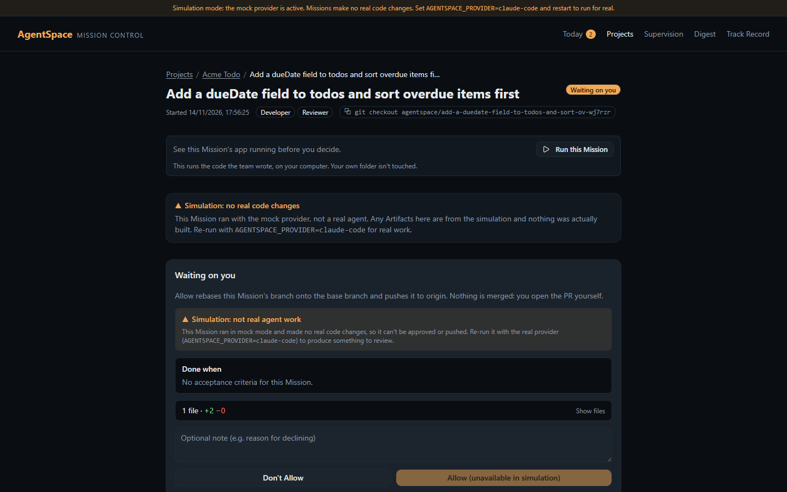
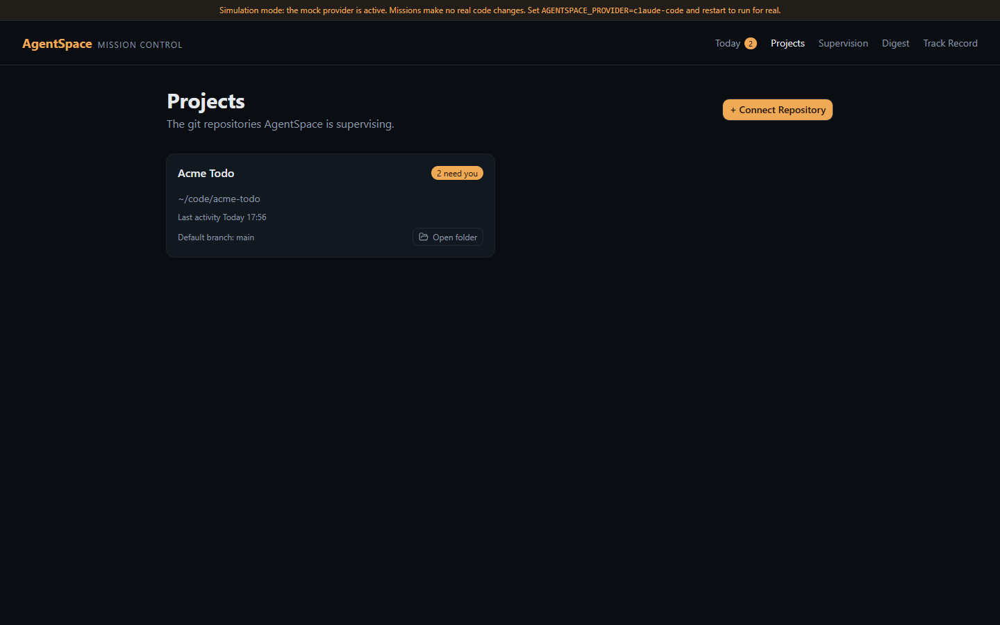
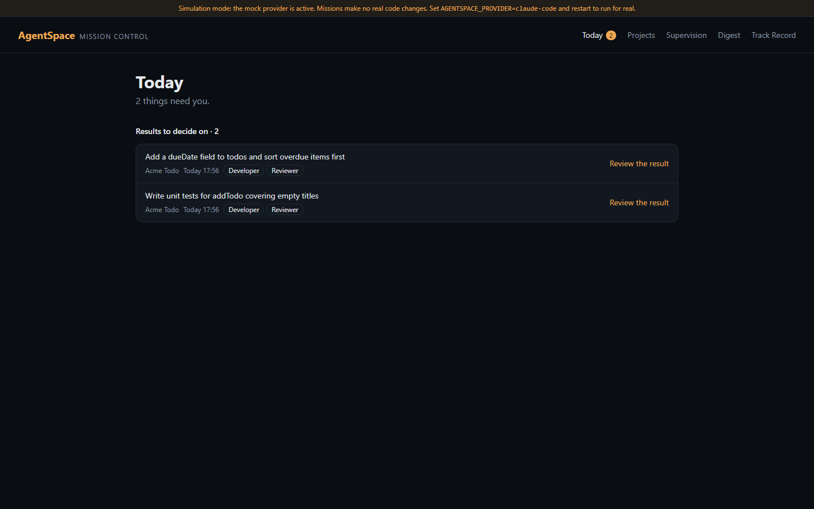
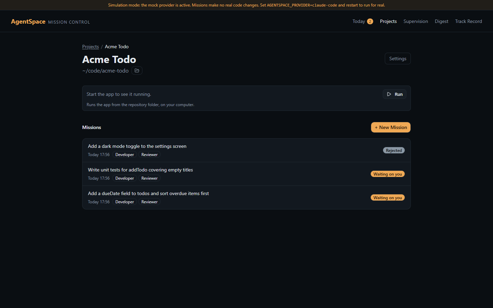
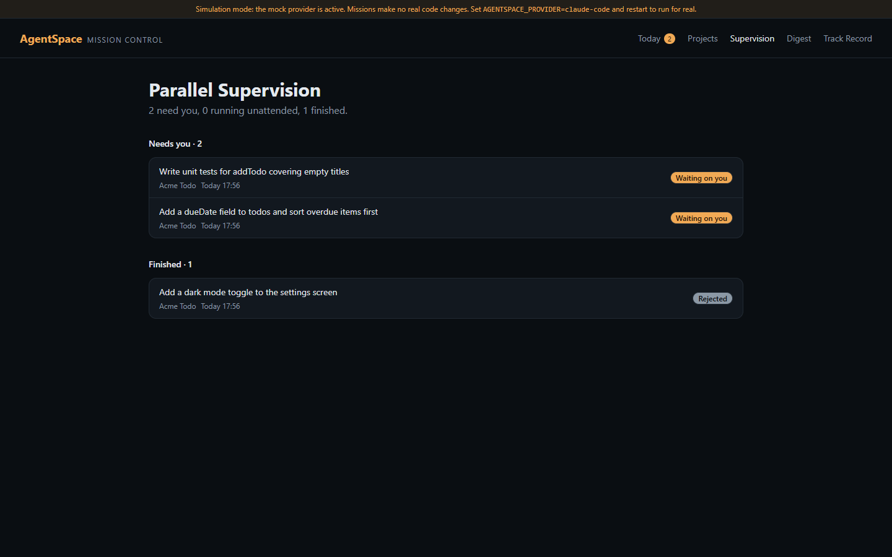
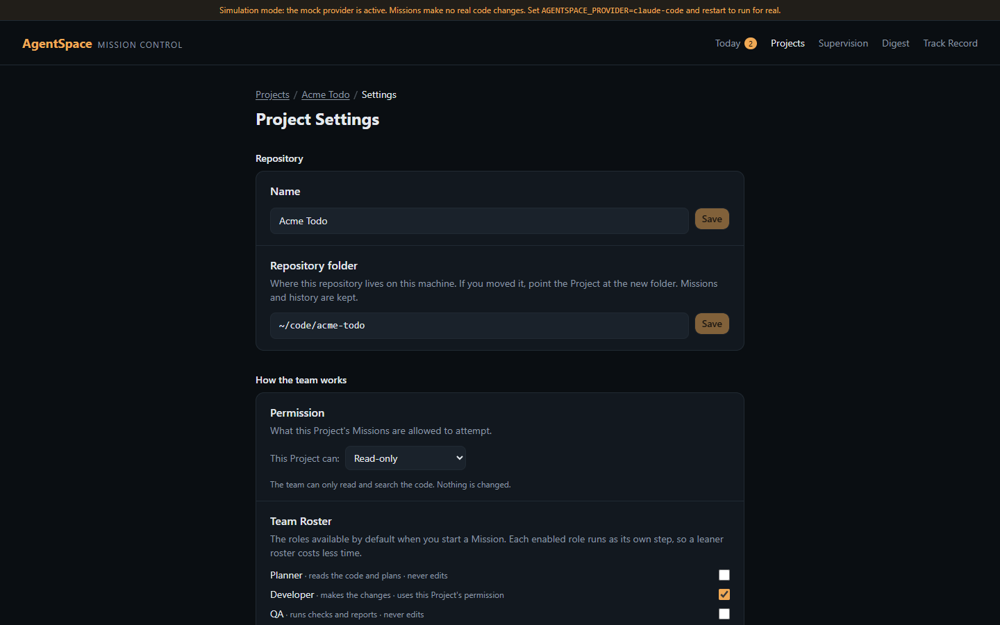

# AgentSpace

**Mission control for an AI software team working inside your own git repository.**

**Landing page:** https://agentspace-miguel.vercel.app

You describe a *Mission* ("add a dueDate field and sort overdue items first"). AgentSpace gives it to a team of AI roles (Planner, Developer, QA, Reviewer, Challenger), which work in an isolated git worktree on its own branch. You then see what resulted and what evidence backs it before deciding anything. Nothing reaches your protected branch without a human decision. AgentSpace never merges and never opens a PR for you.

It is deliberately **not** a chat UI and not a ticket tracker. It's a calm supervision surface: you start Missions, step away, and come back to results that are ready for a decision.

<p align="center">
  
</p>

> The screenshots run on the built-in **mock provider** (simulation mode) against a throwaway demo repository, which is why they show the "Simulation" banners.

## How it works

```
 You ──► New Mission (brief + acceptance criteria + team)
            │
            ▼
   Mission Engine ── state, policy, approval gates, Timeline, Trust Ledger
            │
            ▼
   Execution Engine ── git worktree per Mission · readable branch · diff · build check
            │
            ▼
   Provider Adapter ── the only layer that knows about Claude Code (or the mock)
            │
            ▼
   Evidence + Artifacts ──► "Waiting on you" ──► Allow / Don't Allow / Adjust
```

1. **Connect a repository.** Point at a local folder, or let AgentSpace clone a remote. It detects the default branch and treats it as protected.
2. **Start a Mission.** Write a brief and optional acceptance criteria, then choose which Team Members take part.
3. **The team runs.** Each enabled role is its own sequential headless `claude -p` call in the same worktree, in the order Planner → Developer → QA → Reviewer. Evidence streams in live, tagged by role. A Mission can pause to ask you a question or to have its plan reviewed, and it resumes afterwards.
4. **You decide.** The Approval Gate shows the diff, the build/test result before and after, AI reviews and a "second opinion" from the Challenger. **Allow** rebases the branch onto the base and pushes it to `origin` using your existing git credentials. Opening the PR is up to you.

## Features

- **Projects dashboard** with a "needs you" count per repository.
- **Today.** Everything that's waiting on you, across all projects.
- **Parallel Supervision.** Running, waiting and finished Missions side by side, refreshed live over SSE.
- **Mission detail.** Approval Gate, file diffs, a reasoning summary grounded in the evidence, reviews, decisions and the raw evidence (collapsed under "Process").
- **Team roster per Project.** Enable or disable Planner, Developer, QA, Reviewer and Challenger, with per-role instructions and tool limits. QA only reports, it never edits.
- **Permission policy per Project:** `read-only`, `can-edit`, `can-edit-and-run` or `custom` (allowed and disallowed tool lists).
- **Build verification.** The project's build/test command runs on both the base commit and the result. This tells "this Mission broke it" apart from "it was already broken".
- **Bounded correction loop.** An iterate cycle is capped by `AGENTSPACE_ITERATE_CAP`, so a stuck Mission comes back to you instead of looping.
- **Run the app.** Start the project, or a specific Mission's version of it, from the UI to see it working before you decide.
- **Digest and Track Record.** A summary of what happened, plus your own history of binding decisions (the Trust Ledger).
- **Usage awareness.** Rate-limit events show up as a calm pill, and a Mission that hits the limit pauses and resumes instead of failing.
- **Routines.** Recurring prompts on a cadence that *propose* Missions for you to confirm or dismiss. They never start work on their own.
- **Stacked Missions.** Build a Mission on top of another Mission's branch, compare attempts, and copy a ready-made PR description.

<p align="center">
  
  
</p>
<p align="center">
  
  
</p>
<p align="center">
  
</p>

## Getting started

**Requirements:** Node.js **22.13+** (24 recommended) for the built-in `node:sqlite`, and git. To run real Missions you also need the [Claude Code](https://docs.claude.com/en/docs/claude-code) CLI installed and logged in.

```bash
npm install
npm install --prefix web
cp .env.example .env        # npm run dev loads .env, so it must exist (even empty)
npm run dev:all             # API on :4310 + Vite dev server on :5173
```

Open **http://localhost:5173** for day-to-day work with hot reload.

To have Express serve the built frontend directly on **http://localhost:4310**:

```bash
npm run build:web           # builds web/ into dist-web/
npm run dev                 # Express picks dist-web/ up automatically
```

> `:4310` always shows the **last** `build:web`. Use `:5173` while developing.

### Mock vs. real provider

By default, `AGENTSPACE_PROVIDER=mock` runs instant, simulated Missions with no AI calls. Simulated work can never be approved or pushed. To use the real team, set:

```bash
AGENTSPACE_PROVIDER=claude-code
```

For a production-style start, build and run with `NODE_ENV=production`:

```bash
npm run build && npm run build:web
NODE_ENV=production npm start
```

On Windows PowerShell, use `$env:NODE_ENV="production"; npm start` instead.

In that mode the server refuses to run on the mock provider unless you explicitly set `AGENTSPACE_ALLOW_MOCK=1`, so a forgotten `AGENTSPACE_PROVIDER` can't silently simulate every Mission.

### Configuration

| Variable | Default | Purpose |
|---|---|---|
| `AGENTSPACE_PROVIDER` | `mock` | `claude-code` to run the real CLI |
| `PORT` | `4310` | Express port. If you change it, also update `API_TARGET` in `web/vite.config.ts`, which the dev proxy uses |
| `HOST` | `127.0.0.1` | Interface to bind. Keep it on loopback; see [Security](#security) |
| `AGENTSPACE_DATA_DIR` | `./data` | SQLite store (`agentspace.db`) |
| `AGENTSPACE_WORKTREE_DIR` | `./worktrees` | Where Mission worktrees are created |
| `AGENTSPACE_REPOS_DIR` | `<data dir>/repos` | Where cloned repositories are placed |
| `AGENTSPACE_ITERATE_CAP` | `3` | Max autonomous correction rounds per Mission |
| `AGENTSPACE_MAX_CONCURRENT_EXECUTIONS` | `2` | Parallel Executions |
| `AGENTSPACE_MAX_QUESTIONS` | `3` | Max questions a Mission may ask you; after that the team must make an assumption and say so |
| `AGENTSPACE_PREVIEW_START_TIMEOUT_MS` | `120000` | How long "Run" waits for the app to come up |
| `AGENTSPACE_ROUTINE_TICK_MS` | `600000` | How often routines are checked |
| `AGENTSPACE_BUILD_TIMEOUT_MS` | `300000` | Timeout for the build/test check |

`data/` and `worktrees/` are local runtime state and are gitignored. Delete `data/agentspace.db` to start fresh.

## Security

AgentSpace is a **local, single-user tool**, and it runs git and shell commands on your machine: Missions, plus the "Run" button, which executes the project's configured command. For that reason:

- the server binds to `127.0.0.1` only;
- requests whose `Host` isn't localhost, or whose `Origin` isn't AgentSpace's own page (`:4310` or the Vite dev server on `:5173`), are rejected. This blocks other websites, other local apps and DNS-rebinding attacks;
- there is no authentication, so **don't expose it to a network** (no `HOST=0.0.0.0`, no tunnels, no reverse proxy);
- a Project's GitHub token and `.env` values are stored unencrypted in the local SQLite file under `data/`.

## Architecture

| Layer | Folder | Responsibility |
|---|---|---|
| Mission Engine | `src/mission-engine/` | Mission state machine, team roster, approval policy, iterate bounding, Timeline, Trust Ledger, reviews |
| Execution Engine | `src/execution-engine/` | Worktree lifecycle, branch naming, diffs, build check, previews, routines, rebase/push |
| Provider Adapter | `src/provider-adapter/` | `claudeCodeAdapter.ts` (headless `claude -p --output-format stream-json --verbose`) and `mockAdapter.ts` |
| API | `src/api/` | Express routes for the contract in `docs/07-SCHEMA_API_CONTRACT.md`, plus SSE at `GET /api/events` |
| Storage | `src/db/` | `node:sqlite`, schema mirrored in `src/domain/types.ts` |
| Frontend | `web/` | React + TypeScript + Vite, Tailwind v4, shadcn/ui, dark-only theme |

If you're tempted to import anything Claude-Code-specific outside `provider-adapter/`, it belongs in the adapter (see `docs/19-ARCHITECTURAL_TESTS.md`). `web/src/lib/types.ts` mirrors `src/domain/types.ts` by hand, so keep the two in sync.

## Documentation

The product spec lives in `docs/`. Read it in this order:

| Doc | Topic |
|---|---|
| [`00-VISION`](docs/00-VISION.md) | Why this exists |
| [`01-PRD`](docs/01-PRD.md) | Scope of v1 (solo developer) |
| [`02-DOMAIN`](docs/02-DOMAIN.md) | Mission, Team Member, Project, Decision… |
| [`03-ARCHITECTURE`](docs/03-ARCHITECTURE.md) | The three layers |
| [`04-USER_JOURNEYS`](docs/04-USER_JOURNEYS.md) | End-to-end flows |
| [`06-DESIGN_GUARDRAILS`](docs/06-DESIGN_GUARDRAILS.md) | UI rules (no live percentages, always a human decision…) |
| [`07-SCHEMA_API_CONTRACT`](docs/07-SCHEMA_API_CONTRACT.md) | Schema and HTTP contract |
| [`20-UBIQUITOUS_LANGUAGE`](docs/20-UBIQUITOUS_LANGUAGE.md) | Vocabulary |

Code comments sometimes cite `.claude/plans/*` or ADRs. Those are the author's working notes and aren't part of the public repository.

## Status

This is a personal project under active development. Not built yet:

- multi-provider teams, such as Codex for some roles.

Implemented but not yet validated end to end: GitHub "Checks" (branch / PR / CI status) in the Approval Gate, using a per-Project GitHub token.

## License

[MIT](LICENSE). The vendored `frontend-design` agent skill (`.claude/skills/`, `.agents/skills/`) keeps its own license (see its `LICENSE.txt`).
